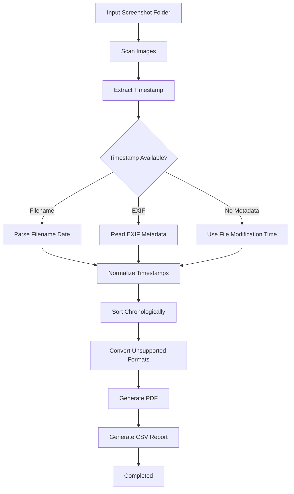

# 📸 PDF Creator - Chronological Image to PDF Converter

\<p align="center">   \<strong>Turn a folder full of screenshots into a beautifully ordered PDF.\</strong>   \<br>   Automatically organize iPhone and macOS screenshots by their capture date and time, then combine them into a single PDF. \</p>

\<p align="center">   ![Python]\([https://img.shields.io/badge/Python-3.9%2B-blue?logo=python](https://img.shields.io/badge/Python-3.9%2B-blue?logo=python))   ![Platform]\([https://img.shields.io/badge/Platform-macOS-lightgrey?logo=apple](https://img.shields.io/badge/Platform-macOS-lightgrey?logo=apple))   ![License]\([https://img.shields.io/badge/License-MIT-green](https://img.shields.io/badge/License-MIT-green))   ![Status]\([https://img.shields.io/badge/Status-Active-success](https://img.shields.io/badge/Status-Active-success)) \</p>

---

## 📖 Table of Contents

- [Overview](#-overview)
- [Features](#-features)
- [How It Works](#-how-it-works)
- [Supported Formats](#-supported-image-formats)
- [Project Structure](#-project-structure)
- [Prerequisites](#-prerequisites)
- [Installation](#-installation)
- [Usage](#-usage)
- [Timestamp Extraction Logic](#-timestamp-extraction-logic)
- [Output Files](#-output-files)
- [Configuration](#️-configuration)
- [Troubleshooting](#-troubleshooting)
- [Future Improvements](#-future-improvements)
- [Contributing](#-contributing)
- [License](#-license)

---

## 🚀 Overview

Have you ever had hundreds of screenshots scattered across your MacBook and iPhone, with no proper chronological order?

Manually arranging them before creating a PDF is tedious.

**PDF Creator** automates this entire process.

Simply place your images inside an input folder, execute the Python script, and let it:

1. Scan the folder for supported images.
2. Extract their original capture timestamps where available.
3. Identify timestamps from macOS screenshot filenames.
4. Sort all images chronologically.
5. Generate a consolidated PDF.
6. Create a CSV report documenting the final image sequence.

The goal is simple: **One folder → One chronological PDF.**

---

## ✨ Features

| Feature                  | Description                                                                  |
| ------------------------ | ---------------------------------------------------------------------------- |
| 📱 iPhone Support        | Extracts image timestamps from EXIF metadata                                 |
| 💻 macOS Support         | Recognizes timestamps embedded in macOS screenshot filenames                 |
| 🕒 Chronological Sorting | Arranges images from oldest to newest                                        |
| 🌍 Timezone Handling     | Normalizes timezone-aware timestamps before sorting                          |
| 📄 PDF Generation        | Combines images into one PDF                                                 |
| 📊 CSV Report            | Records image order, date, time and timestamp source                         |
| 🔄 Format Conversion     | Converts supported non-JPEG/PNG formats to JPEG                              |
| 🧭 Orientation Handling  | Applies image orientation metadata during conversion                         |
| 🛡️ Error Handling       | Skips unsupported or corrupted images instead of stopping the entire process |

---

## ⚙️ How It Works

The application follows a simple processing pipeline.



### Timestamp extraction priority

The script uses the following priority:

1. macOS screenshot filename.
2. EXIF metadata.
3. Filesystem modification time.

This helps preserve the original capture sequence even when images originate from different devices.

---

## 🖼️ Supported Image Formats

| Format | Extension       | Support |
| ------ | --------------- | ------- |
| JPEG   | `.jpg`, `.jpeg` | ✅       |
| PNG    | `.png`          | ✅       |
| HEIC   | `.heic`         | ✅       |
| TIFF   | `.tiff`         | ✅       |
| BMP    | `.bmp`          | ✅       |
| WebP   | `.webp`         | ✅       |

**Note:** HEIC, TIFF, BMP and WebP images are converted to JPEG before being included in the PDF. JPEG and PNG images are passed directly to the PDF generator.

---

## 📁 Project Structure

```text
PDF-Creator/
│
├── image_to_pdf.py
│
├── screenshots/
│   ├── IMG_1023.HEIC
│   ├── IMG_1024.HEIC
│   ├── Screenshot 2026-11-14 at 10.30.12 AM.png
│   ├── Screenshot 2026-11-14 at 11.30.12 AM.png
│   └── image.jpg
│
├── combined_screenshots.pdf
├── image_order.csv
│
├── requirements.txt
├── README.md
│
└── venv/
```

**Important:** The `venv/` directory is generated locally and should not be committed to GitHub.

Recommended `.gitignore`:

```gitignore
venv/
__pycache__/
*.pyc
.DS_Store
_temp_*
```

---

## 🧰 Prerequisites

Before starting, ensure you have:

- macOS
- Python 3.9 or later
- Homebrew
- ExifTool

### Check Python

```bash
python3 --version
```

### Check Homebrew

```bash
brew --version
```

### Install ExifTool

ExifTool is used to extract image metadata.

```bash
brew install exiftool
```

Verify:

```bash
exiftool -ver
```

---

## 📦 Installation

### Step 1: Clone the repository

```bash
git clone https://github.com/YOUR_USERNAME/PDF-Creator.git
```

Navigate into the project:

```bash
cd PDF-Creator
```

### Step 2: Create a virtual environment

Modern macOS Python installations may prevent global package installations due to PEP 668.

Create an isolated environment:

```bash
python3 -m venv venv
```

### Step 3: Activate the environment

```bash
source venv/bin/activate
```

Your terminal should now display:

```text
(venv) user@Mac PDF Creator %
```

### Step 4: Install Python dependencies

```bash
python -m pip install --upgrade pip
```

```bash
python -m pip install Pillow img2pdf
```

Alternatively, create a `requirements.txt` file:

```text
Pillow
img2pdf
```

Then install:

```bash
python -m pip install -r requirements.txt
```

### Step 5: Prepare your input folder

Create a folder named `screenshots` in the project directory.

```bash
mkdir -p screenshots
```

Copy your iPhone and MacBook screenshots into this folder.

---

## ▶️ Usage

### 1. Add your images

Example:

```text
screenshots/
├── IMG_1001.HEIC
├── IMG_1002.HEIC
├── Screenshot 2026-11-14 at 10.30.12 AM.png
├── Screenshot 2026-11-14 at 11.30.12 AM.png
└── notes.jpg
```

### 2. Execute the script

```bash
python image_to_pdf.py
```

### 3. View the processing output

Example:

```text
Reading images...

Found 5 images.

Sorting images chronologically...

========== IMAGE ORDER ==========

001. IMG_1001.HEIC | 2026-11-14 09:15:00 | Source: EXIF
002. Screenshot 2026-11-14 at 10.30.12 AM.png | 2026-11-14 10:30:12 | Source: Filename
003. IMG_1002.HEIC | 2026-11-14 10:45:00 | Source: EXIF
004. notes.jpg | 2026-11-14 11:00:00 | Source: File Modified Time
005. Screenshot 2026-11-14 at 11.30.12 AM.png | 2026-11-14 11:30:12 | Source: Filename

=================================

Generating PDF...

PDF successfully created: combined_screenshots.pdf

CSV report created: image_order.csv

All tasks completed!
```

*Example output for illustration.*

---

## 🕒 Timestamp Extraction Logic

One of the most important parts of this project is determining when an image was captured.

Different devices store timestamps differently.

### 1. macOS screenshots

macOS commonly generates filenames like:

```text
Screenshot 2026-11-14 at 10.30.12 AM.png
```

The script parses the date and time directly from the filename.

### 2. iPhone screenshots and photos

Image metadata may contain fields such as:

- `DateTimeOriginal`
- `CreateDate`
- `MediaCreateDate`
- `TrackCreateDate`

ExifTool is used to retrieve these values.

### 3. Filesystem fallback

If neither the filename nor EXIF metadata contains a usable timestamp, the script uses:

```python
os.path.getmtime(filepath)
```

This retrieves the file's modification time.

**Important:** Modification time is not necessarily the original capture time. Copying, downloading or transferring images may change it.

### 4. Timezone normalization

Python distinguishes between timezone-aware and timezone-naive datetime objects.

To prevent comparison errors, the script converts timezone-aware timestamps to the Mac's local timezone before sorting.

Images without timezone information are assumed to use local time.

For imported images from different timezones, this assumption may need additional handling.

---

## 📄 Output Files

After successful execution, two files are generated.

### 1. combined_screenshots.pdf

Contains all successfully processed images, arranged chronologically.

- Oldest screenshot appears first.
- Newest screenshot appears last.
- One image is included per PDF page.
- Original aspect ratios are retained by the PDF conversion process.

### 2. image_order.csv

Contains a record of the sorting process.

Example:

| Order | Filename       | Date       | Time     | Source             |
| ----- | -------------- | ---------- | -------- | ------------------ |
| 1     | IMG_1001.HEIC  | 2026-11-14 | 09:15:00 | EXIF               |
| 2     | screenshot.png | 2026-11-14 | 10:30:12 | Filename           |
| 3     | notes.jpg      | 2026-11-14 | 11:00:00 | File Modified Time |

The CSV can be opened using Microsoft Excel, Apple Numbers or Google Sheets.

---

## ⚙️ Configuration

You can customize the application by editing the configuration section in `image_to_pdf.py`.

```python
INPUT_FOLDER = "screenshots"

OUTPUT_PDF = "combined_screenshots.pdf"

OUTPUT_CSV = "image_order.csv"
```

For example, to change the input folder:

```python
INPUT_FOLDER = "MyImages"
```

To change the generated PDF name:

```python
OUTPUT_PDF = "My_Chronological_Images.pdf"
```

---

## 🛠️ Troubleshooting

### Problem 1: `ModuleNotFoundError: No module named 'PIL'`

Install Pillow inside your virtual environment:

```bash
python -m pip install Pillow
```

### Problem 2: `externally-managed-environment`

Create and activate a virtual environment:

```bash
python3 -m venv venv
source venv/bin/activate
```

Then install dependencies.

### Problem 3: `TypeError: can't compare offset-naive and offset-aware datetimes`

Ensure the timestamp normalization function is being used before sorting.

### Problem 4: `exiftool: command not found`

Install ExifTool:

```bash
brew install exiftool
```

### Problem 5: No images found

Verify that:

- The folder is named `screenshots`.
- The images are inside the correct directory.
- The image extensions are supported.

### Problem 6: Incorrect chronological order

Check `image_order.csv`.

Look at the `Timestamp Source` column to identify whether the timestamp came from the filename, EXIF or filesystem.

If the filesystem modification time was used, it may not reflect the original capture date.

---

## 🔮 Future Improvements

The following features are potential additions to the project.

- [ ] GUI interface for selecting folders.
- [ ] Drag-and-drop image upload.
- [ ] Preview images before PDF generation.
- [ ] Manual image reordering.
- [ ] Duplicate image detection.
- [ ] Date-based PDF sections.
- [ ] A4 page layout option.
- [ ] Custom PDF page sizes.
- [ ] Progress bar during processing.
- [ ] Better timezone inference for imported images.
- [ ] Configurable timestamp extraction priority.
- [ ] Recursive folder scanning.
- [ ] Support for multiple PDF exports.
- [ ] Command-line arguments for input and output paths.

---

## 🤝 Contributing

Contributions, bug reports and feature suggestions are welcome!

If you want to contribute:

1. Fork the repository.
2. Create a new branch.
3. Implement your changes.
4. Test your implementation.
5. Submit a pull request.

```bash
git checkout -b feature/new-feature

git add .

git commit -m "Add new feature"

git push origin feature/new-feature
```

---

## 📜 License

This project is licensed under the MIT License.

You are free to use, modify and distribute this project under the terms of the license.

---

\<p align="center">
&#x20; \<strong>Built with Python 🐍\</strong>
&#x20; \<br>
&#x20; Automating the boring stuff, one screenshot at a time.
\</p>
